# Informe técnico · VISUALENCE CV
*Proyecto de prácticas preprofesionales · Consigue Ventas*

## 1. Objetivo
Clasificar el rendimiento esperado de una publicación (**bajo / medio / alto**) y estimar su tasa de interacción **antes de publicarla**,
usando solo información disponible en ese momento (formato, horario, texto e imagen).

## 2. Datos y limpieza
- Filas iniciales: **812** → finales: **785**. Duplicados eliminados: 12; filas sin copy: 15.
- Nulos restantes (se imputan **dentro del pipeline con estadísticos de train**): {'hora': 24, 'tipo_contenido': 20, 'brillo_img': 28, 'alcance': 20}.
- ⚠️ El dataset es **sintético**: sirve para validar el flujo técnico; las conclusiones de negocio requieren datos reales de la agencia.

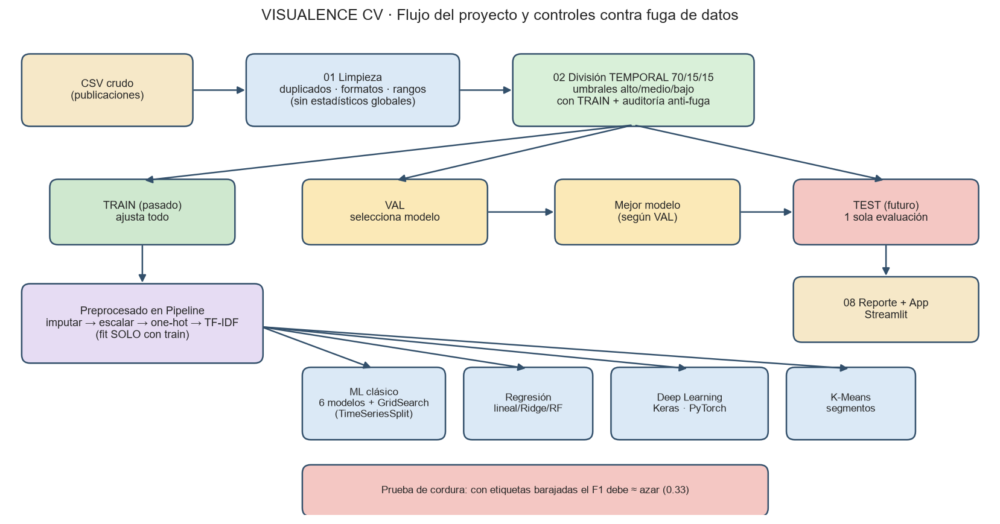

## 3. Prevención de fuga de datos (data leakage)
1. **Solo variables pre-publicación** como entrada; alcance, interacciones, guardados, clics y leads están bloqueados por código (`verificar_sin_fuga`).
2. **División temporal** {'train': 549, 'val': 118, 'test': 118} (train/val/test): se entrena con el pasado y se evalúa con el futuro.
3. **Umbrales de las clases** calculados solo con train: bajo ≤ 0.0511 < medio ≤ 0.0659 < alto.
4. **Preprocesado dentro de un Pipeline**: imputación, escalado, one-hot y TF-IDF se ajustan solo con train.
5. **Ajuste de hiperparámetros** con `TimeSeriesSplit` únicamente sobre train; el mejor modelo se elige con **validación**; **test se usa una sola vez**.
6. **Prueba de cordura**: con etiquetas barajadas el F1 en validación fue **0.386** (azar ≈ 0.33), señal de que no hay fuga.

Auditoría automática:
- ✅ Variables de entrada no incluyen resultados (alcance, clics, leads, etc.)
- ✅ Ningún id_post aparece en más de un conjunto
- ✅ Orden temporal: train ≤ val ≤ test
- ✅ Umbrales alto/medio/bajo calculados solo con train
- ✅ Sin ids duplicados en el dataset

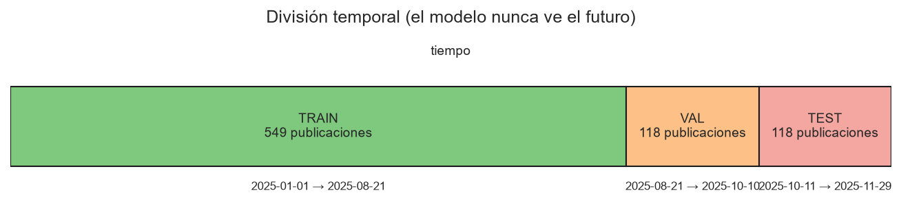

## 4. Análisis exploratorio y estadístico (solo train)
- ANOVA tasa ~ formato: estadístico = 30.05, p = 1.32e-22
- Kruskal-Wallis tasa ~ formato: estadístico = 100.18, p = 9.02e-21
- Chi² formato vs nivel: estadístico = 97.50, p = 1.38e-17
- t-test CTA vs sin CTA: estadístico = 4.97, p = 9.08e-07
- Mann-Whitney CTA vs sin CTA: estadístico = 45799.00, p = 4.27e-06

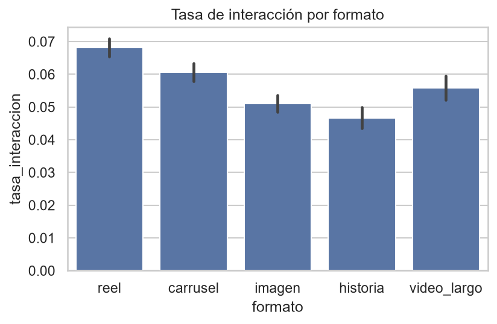 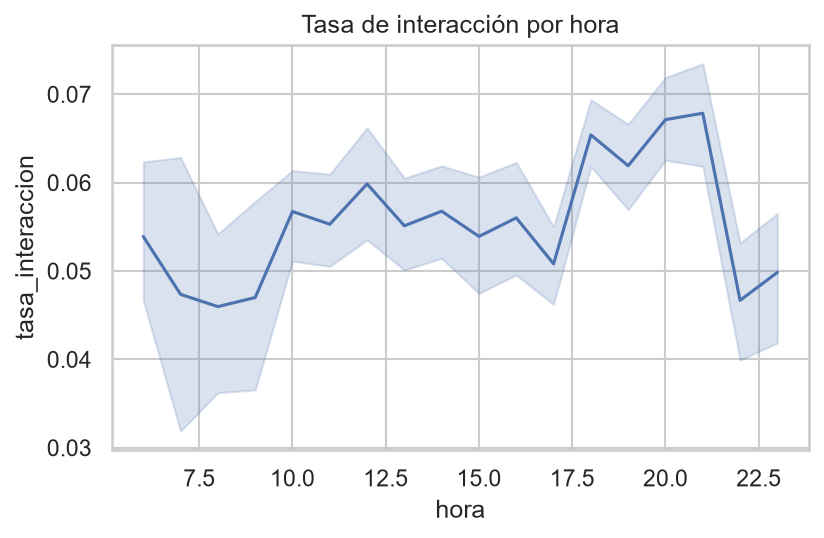
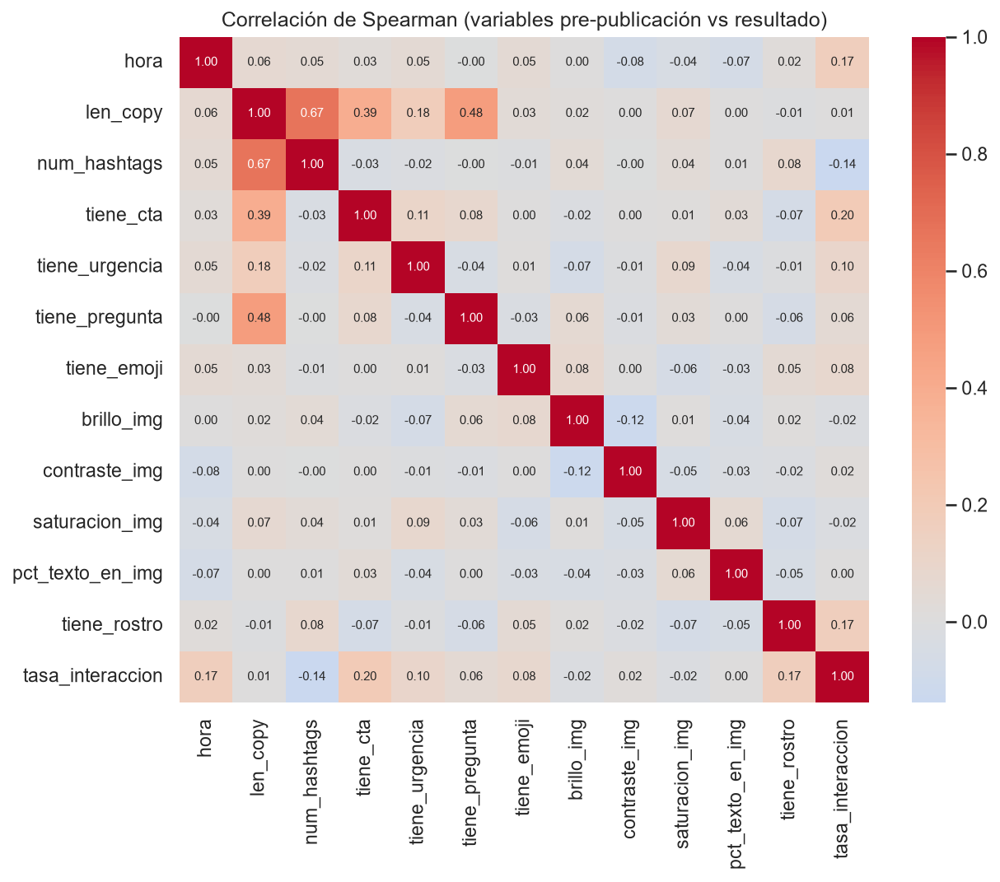
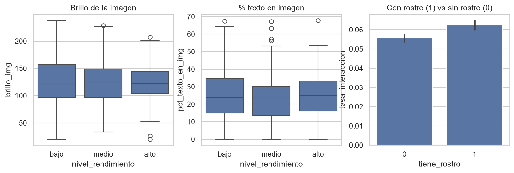
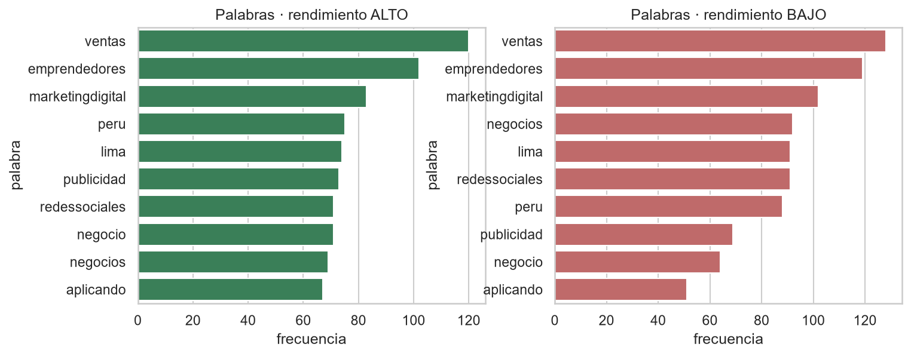

## 5. Machine Learning (clasificación)
| Modelo | CV F1 (train) | F1 val | F1 test | Accuracy test | AUC test |
|---|---|---|---|---|---|
| Línea base | — | 0.193 | 0.156 | 0.305 | nan |
| Regresión logística | 0.511 | 0.474 | 0.475 | 0.492 | nan |
| KNN | 0.407 | 0.354 | 0.444 | 0.449 | nan |
| SVM (RBF) | 0.487 | 0.349 | 0.413 | 0.415 | nan |
| Árbol de decisión | 0.384 | 0.466 | 0.522 | 0.525 | nan |
| Random Forest | 0.455 | 0.483 | 0.432 | 0.441 | nan |
| Gradient Boosting | 0.478 | 0.433 | 0.512 | 0.517 | nan |

Mejor modelo según validación: **Random Forest** · F1 macro en test = **0.432**
(IC 95 % bootstrap: 0.338 – 0.521; línea base = 0.156). Con ~118 publicaciones de test, las diferencias
pequeñas entre modelos **no son concluyentes**.

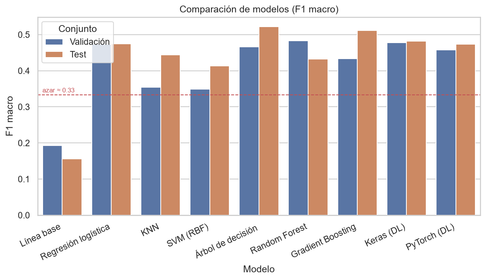
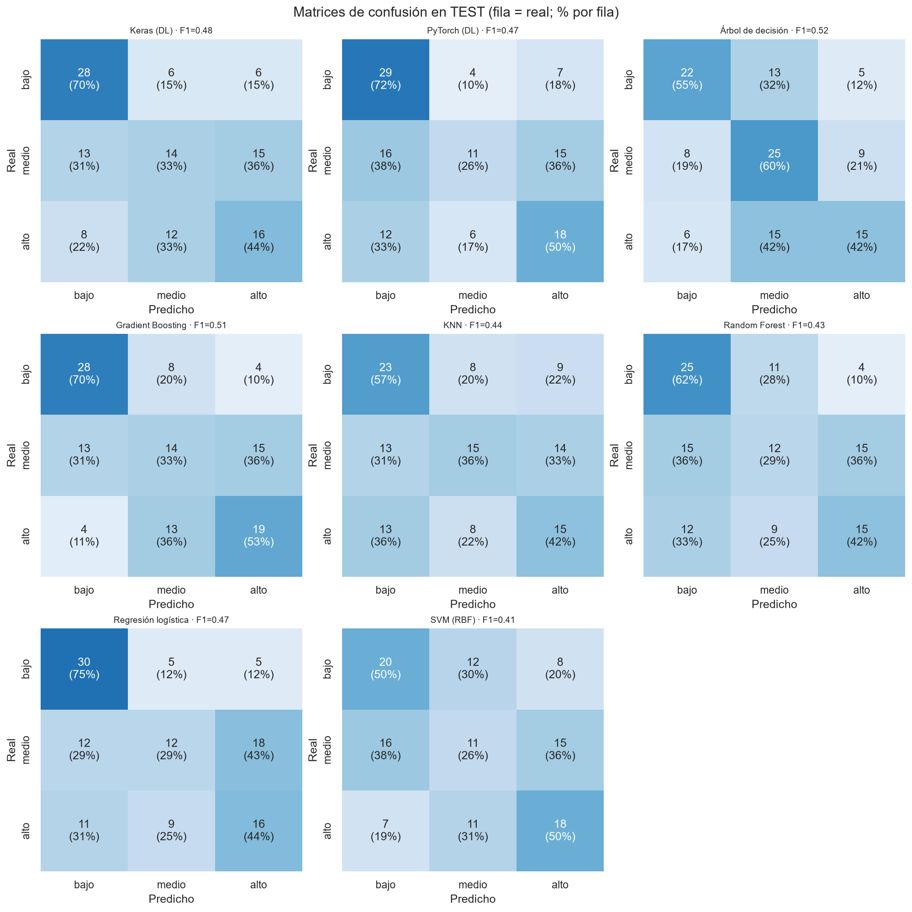
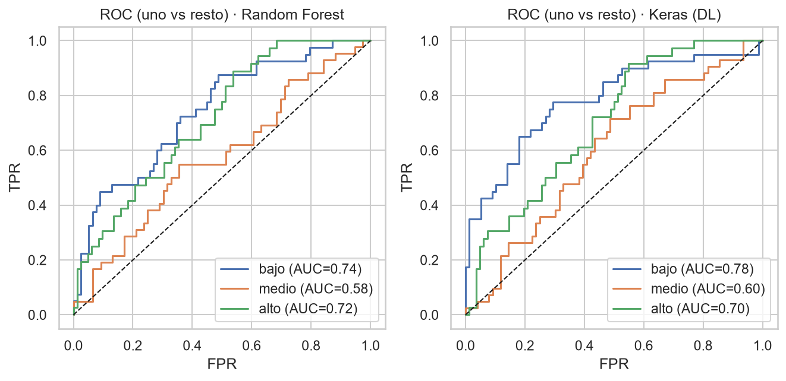
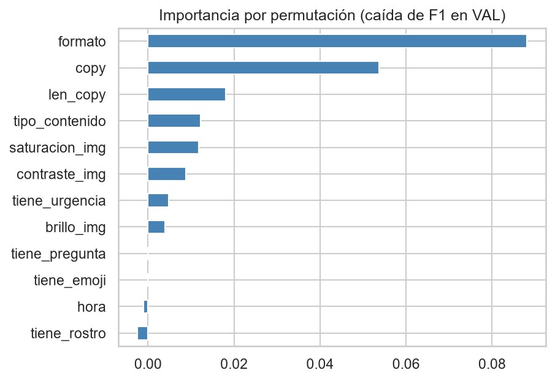 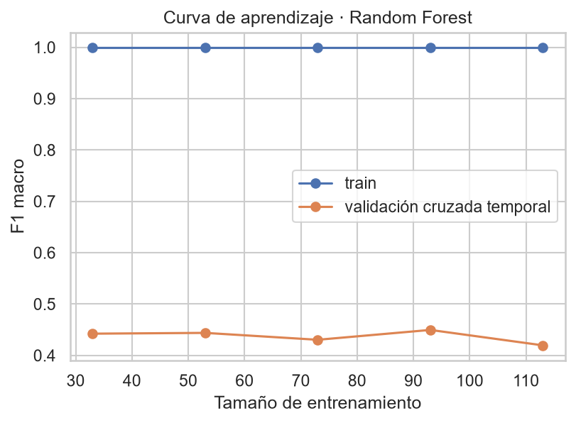

## 6. Deep Learning (Keras vs PyTorch)
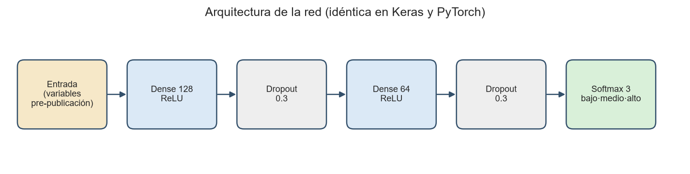

Arquitectura: `Entrada(139) → Dense128+ReLU → Dropout0.3 → Dense64+ReLU → Dropout0.3 → Softmax3`. Hiperparámetros: {'optimizador': 'Adam', 'lr': 0.001, 'lote': 32, 'max_epocas': 200, 'paciencia': 15}.

| Modelo | Épocas | F1 val | F1 test | Accuracy test | AUC test |
|---|---|---|---|---|---|
| Keras | 23 | 0.478 | 0.482 | 0.492 | nan |
| PyTorch | 21 | 0.458 | 0.474 | 0.492 | nan |

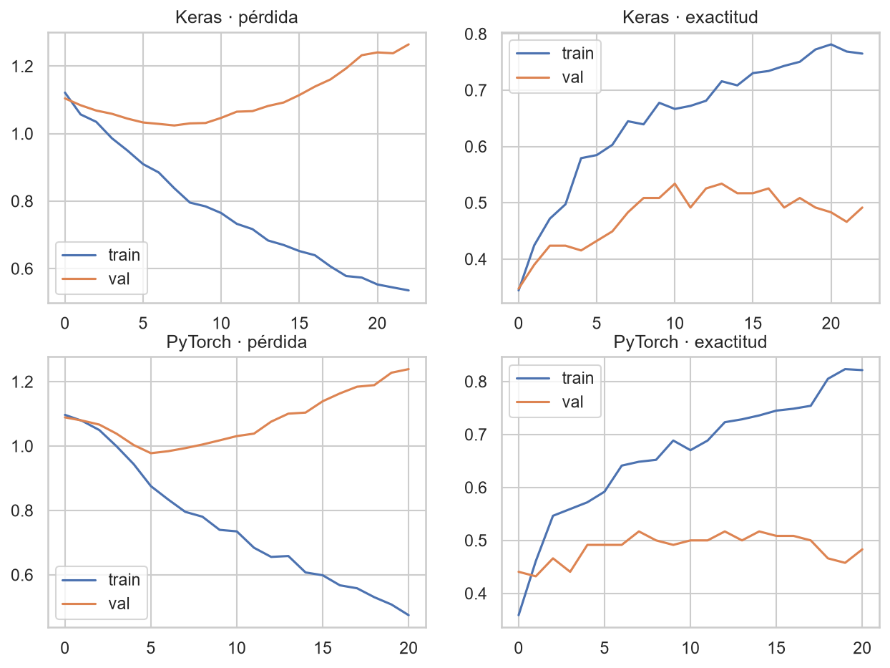

## 7. Regresión de la tasa de interacción
| Modelo | R² val | R² test | MAE test | RMSE test |
|---|---|---|---|---|
| Línea base (media) | -0.042 | -0.004 | 0.0138 | 0.0176 |
| Regresión lineal | 0.264 | 0.347 | 0.0114 | 0.0142 |
| Ridge (α por CV) | 0.268 | 0.347 | 0.0115 | 0.0142 |
| Random Forest (reg.) | 0.274 | 0.362 | 0.0109 | 0.0141 |

Mejor según validación: **Random Forest (reg.)**. Normalidad de residuos (Shapiro-Wilk, test): p = 0.177.

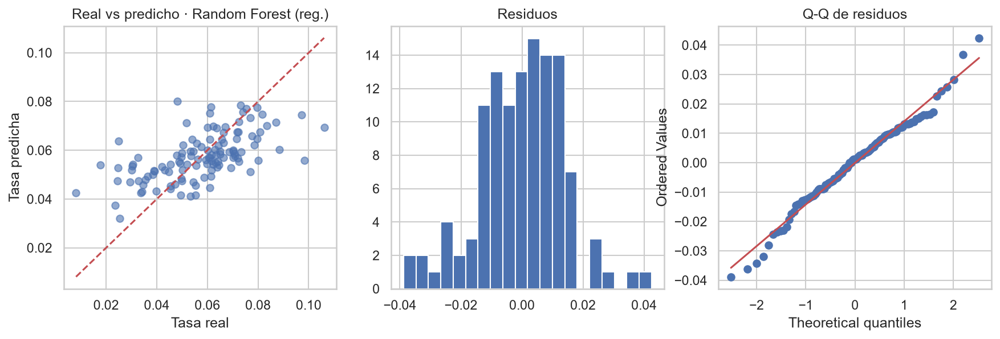 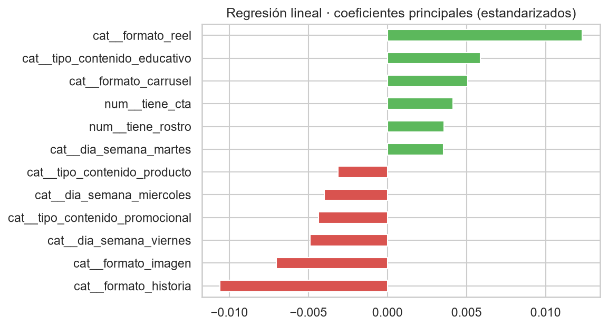

## 8. Segmentación (K-Means)
k óptimo por silhouette = **2** (silhouette = 0.085, separación débil). Validación en test:

| segmento | publicaciones | tasa_prom |
|---|---|---|
| 0.0 | 70.0 | 0.055 |
| 1.0 | 48.0 | 0.062 |

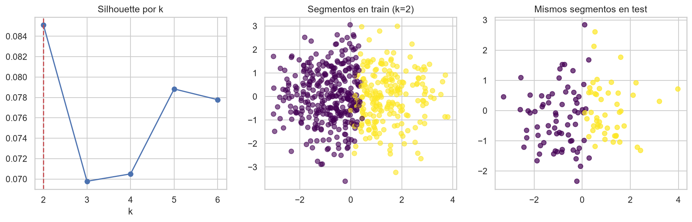

## 9. Visión computacional
OpenCV extrae brillo, contraste, saturación, presencia de rostro (Haar) y una **estimación aproximada** del % de texto en la imagen (`vlc/vision.py`).

## 10. Limitaciones y mejoras
- Dataset sintético y pequeño; reentrenar con 100–300+ publicaciones reales (`10_features_imagenes.py` calcula las variables de imagen).
- Con pocos datos, los modelos simples (logística, árbol, bosque) suelen igualar o superar a las redes neuronales.
- Mejora futura: *embeddings* de imagen con una red preentrenada, seguimiento del modelo en producción y reentrenamiento periódico.
